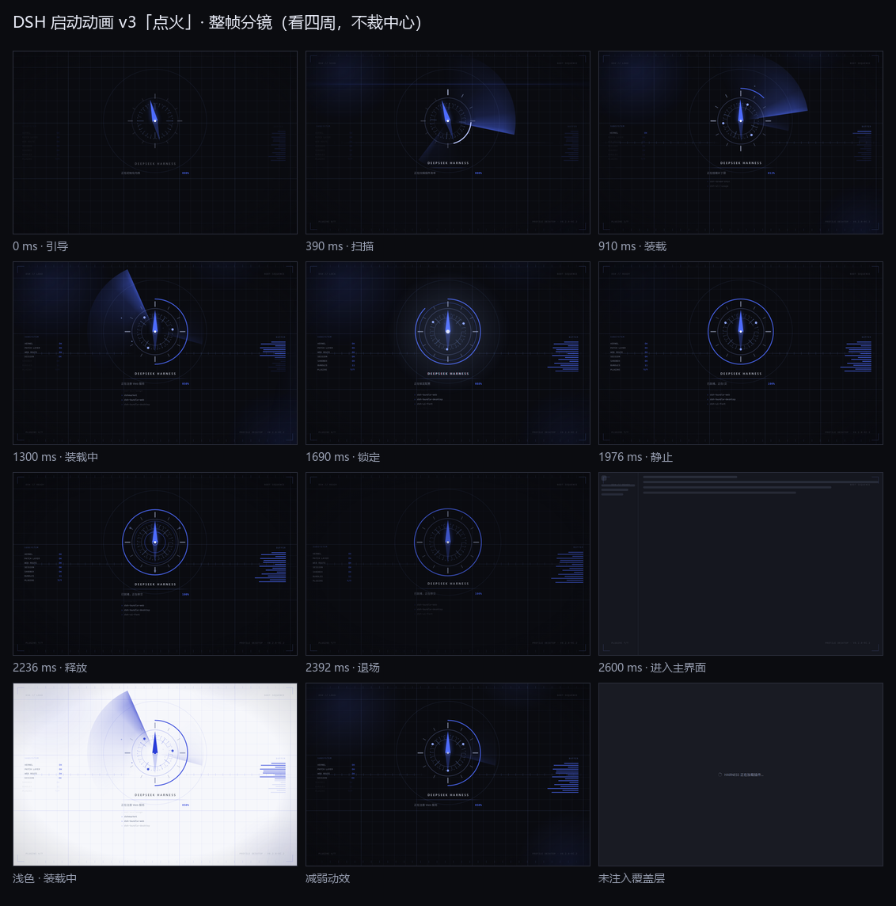

# dsh-boot-compass

DSH 启动动画「点火 / Ignition」—— 七段罗盘序列，纯代码，零视频资源。



> **想直接看效果**：双击 [`tools/preview.html`](tools/preview.html) —— 单文件、零依赖，
> 用的是宿主侧 `apply()` 真实产出的注入行。点一下屏幕就能试「跳过」。


```
引导 INIT → 扫描 SCAN → 装载 LOAD → 锁定 LOCK → 静止 HOLD → 释放 RELEASE → 退场 EXIT
   9%         21%        32%        12%        6%         8%          12%
```

全片 3 秒，**完整播完才进主界面**。宿主若在 0.76 仍未就绪，动画冻结在「静止」那一帧
等待 —— 那一帧本来就是静止的，等多久都不难看。

---

## 它为什么必须是宿主侧插件

DSH 的加载卡（`HARNESS / Loading plugins…`）由 shell 在**任何客户端插件被实例化之前**
就画出来了。所以只从自己 JS 里画动画的插件，无论 z-index 多高，都必然让那张卡在屏幕上
停留几百毫秒。唯一比它更早的界面是**被服务的文档本身**，而 DSH 把它开放出来：
`webserver/index-inject` 收集一组 index 行，载体在 `<head>` 还在解析时就渲染进
index.html —— 早于构建那张卡的 shell 内核。

因此这里的两半是：

| 行 | 内容 | 作用 |
|---|---|---|
| `style` | 407 B | 纯 CSS 覆盖层 `html.dshboot-on::before` + 两个 Desktop 标题栏 token。**不需要 DOM**，所以样式行一被解析就在玻璃上 |
| `script` | ~44 KB | 把 `boot.css` / `boot.html` 赋成全局，随后挂载到 **shadow root**，并在同一个任务里撤掉覆盖层 |

资产是在**同一个 script 行**里拼接的，而不是用单独的行：`boot.js` 第一件事就是读那两个
全局，而 `{kind:'global'}` 行相对于 script 行的渲染位置无法在本包内验证，弄错就是黑屏。
拼在同一个字符串里，顺序就成了字符串的性质，而不是载体的性质。

**shadow root** 是让 `boot.css` 保持原生写法的原因：边界双向隔离，既不会漏进应用，
应用也够不到启动画面。所以那份 CSS 几乎是评审版原文。

---

## 安装

**桌面客户端独占管理 `desktop` profile** —— `dsh plugin` 内部就是
`profile.toLowerCase() === "desktop"` 直接拒绝。所以本机要在
**设置 → 插件**里安装：

```bash
npm pack                       # 在包目录里产出 dsh-boot-compass-0.1.0.tgz
```
然后把 tarball 在「设置 → 插件」里装上，重启客户端。

非 desktop 的 profile 可以用 CLI：

```bash
dsh plugin --profile <name> add dsh-boot-compass
```

## 开关与调节

宿主侧插件目前**没有设置界面**（见下方「还没做」），所以用这三个 localStorage 键：

| 键 | 值 | 说明 |
|---|---|---|
| `dsh-boot-compass:mode` | `off` | 完全不注入 —— 覆盖层和启动画面都不出现，直接进 DSH |
| `dsh-boot-compass:theme` | `light` / `dark` | 强制主题；不设则跟随 `prefers-color-scheme` |
| `dsh-boot-compass:total` | 毫秒，800–12000 | 覆盖全片时长；不设则用 `boot.css` 里的 `--total`（3000） |

在开发者工具控制台里：

```js
localStorage.setItem('dsh-boot-compass:mode','off')   // 关掉
localStorage.removeItem('dsh-boot-compass:mode')      // 打开
```

**总时长只有一个来源**：`lib/boot.css` 里的 `--total`。`boot.js` 从
`getComputedStyle(host)` 读它，不从常数读 —— 改一处即可，不会出现"改了 3000 但文件里
还是 2600"这种漂移。

## 跳过：点一下直接进主界面

**点屏幕任意处**（或 `Esc` / `空格` / `Enter`）立刻进入主界面。

它不是硬切，而是**把整条时间轴整体前推到 0.80（释放点）**：`--t0` 是 `.a` 的
`animation-delay` 里被减掉的那一项，所以给它加一个增量就等于把**所有**动画同时前推，
JS 时钟再重新锚定对齐。因此冲击波、节点飞出、穿镜头、交接这四拍仍然会放完 ——
约 0.6 秒，看起来像一个有意的快退，而不是画面被掐掉。

点击监听挂在 `window` 的捕获阶段，而不是 host 上：host 是
`pointer-events:none`（它只是画面，不是 UI），所以监听 window 才既能接住点击，
又不会挡住应用。

### 给宿主/其它插件用的控制面

```js
window.__dshBoot.ready()    // 立即开闸。比轮询 [data-dsh-boot] 更准 —— 你直接说"我好了"
window.__dshBoot.skip()     // 程序化跳过，等价于用户点了一下
window.__dshBoot.state()    // { progress, held, released, finished, total }
```

`ready()` 是推荐的接入方式：轮询只能从"那张卡消失了"**推断**就绪，而 `ready()` 是被告知。

## 就绪 gate

播放 0 → 0.76 是**无条件**的。到 0.76 时：

* 已就绪 → 一路播到 1.00，然后交接。这是常态。
* 未就绪 → 在 HOLD 帧冻结（`--ps: paused` 写在 **host 的行内样式**上），
  等就绪信号后放行。
* 12000 ms 硬上限 → 无条件放行，慢应用不会被永久挡住。

就绪信号按优先级：`window.__DSH_BOOT_READY__ === true` →
`[data-dsh-boot]` 出现过又消失（应用已挂载）→
那张卡丢掉了 `[data-dsh-boot-spinner]`（卡自己进了失败态，页面必须可读）。

**gate 点是 0.76 而不是 0.80**：0.74–0.80 是 HOLD，这一整段里没有任何元素在动，
所以冻结它不会有任何一帧被切在半途。

## 开发工具（不随包发布）

```bash
node tools/build-preview.mjs   # 调真实的 apply()，把产出的行写成 tools/preview.html
node tools/diag.mjs            # 同上，但把 DOM 状态打印进页面里
```

`build-preview.mjs` **不重新实现注入**：它 import `lib/index.js`，用一个假 ctx 跑
`apply()`，把拿到的行逐字写进页面，并断言资产全局出现在 boot IIFE 之前。所以预览对了，
行就是对的 —— 从副本搭的预览可能在真正代码坏掉时依然通过。

预览页支持 `?delay=6000`（拖慢就绪以观察 gate）、`?theme=light`、`?mode=off`。

## 还没做

* **设置界面。** 本包只有宿主侧，没有 `dsh.client`。要做「通用设置」里的开关/主题/时长，
  需要按 `@deepseek-ai/dsh-client-ui-settings` 的 API 写客户端半边。在此之前开关只能靠
  上面的 localStorage 键。
* **主题在极早时刻只能靠猜。** `prefers-color-scheme` 是应用还没加载任何自己的 CSS 之前
  唯一存在的主题信号。如果 DSH 的主题被设成与系统不一致，启动画面可能是"错"的那一套
  配色，直到交接 —— 覆盖层底色是刻意选的中性近黑/近白，就是为了让这段偏差尽量不刺眼。
  真正的修法是读 DSH 持久化的主题键，但那需要先确认它的键名。
* **没有实测过真实启动。** 逻辑与渲染已逐项验证（见下），但"装进 profile 后第一次真正
  启动"还没跑过 —— 本机 `desktop` profile 只能由应用自己安装。

## 验证过的部分

| 项 | 怎么验的 | 结果 |
|---|---|---|
| `apply()` 产出的行与顺序 | `build-preview.mjs` 断言 | `style, script`；资产全局在 IIFE 之前 |
| shadow 挂载与布局 | `diag.mjs` 打印真实 rect | host 1150×665，`#boot` `display:grid; z-index:4`，`svg.mark` 246×246 居中 |
| 覆盖层撤除 | diag 读 `classList` | `hasCoverClass :: false`，与挂载同一任务 |
| 首帧文字可读 | diag 读 `#st` | `"正在初始化内核"`（第 0 段不做解码） |
| CSS 是否真的作用到 shadow 树 | diag 打印样式表规则数 | 181 条规则 |
| **`--ps` 能否穿过 shadow 边界** | diag 就地设值后重读 `animationPlayState` | `running -> paused   PASS`，移回 `running` |
| 语法 | `node --check` 两个文件 | 退出码 0 |
| 画面真的在画 | 预览截图体积 | 启动画面 228 KB（有纹理）/ 交接后 18 KB（纯占位界面） |
| **gate 会冻结等慢应用** | `?delay=8000` 跑 3000 ms 后截图 | 228 KB —— 冻在 HOLD 帧 |
| **点击确实能直接进主界面** | 同上但 `&skip=600` | 14 KB —— 已退场，绕过了 gate |

最后两行是 A/B：同一个"应用迟迟不就绪"的场景，不点就等，点一下就立刻交接。

## 许可

MIT
