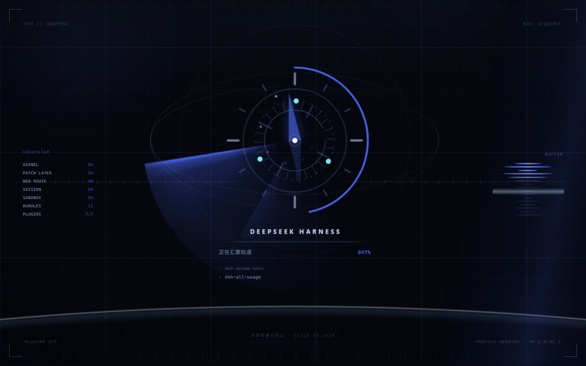
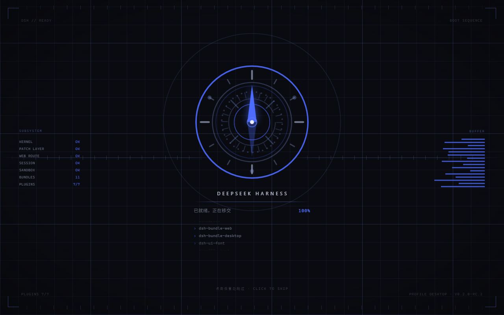
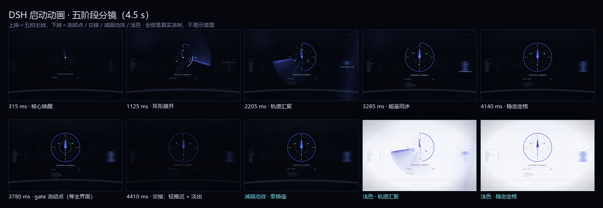

# dsh-boot-compass

**开机那 3 秒，也值得设计一下。**

DSH 启动时会先画一张「HARNESS 正在加载插件…」的卡。这个插件在它出现之前就接住画面，
放一段七拍的罗盘序列，播完再交给主界面。纯代码，零视频资源。

从 0.2.0 起，**关掉窗口再从托盘打开也会重播一遍**；但 alt-tab 切回来不会 —— 下面说为什么。

> A full-screen boot splash for DSH: a CSS cover lands before the loading card is
> painted, a seven-beat compass sequence plays, then the app fades up from inside it.


## 装

**桌面客户端** —— 侧栏 → **插件** → **添加插件**，粘贴这一行：

```
github:linshufan21/dsh-boot-compass
```

装完点**立即启用**，然后**完全退出客户端再打开**。
开机动画是在启动时注入页面的，刷新浏览器看不到。

**其它 profile** 用命令行：

```bash
dsh plugin --profile <name> add github:linshufan21/dsh-boot-compass
```

这条路会顺带把这个组合包写进 profile 的 `dsh.profile.bundles`（也就是启用），
重启那个 profile 即可看到。

> **为什么不能写 `dsh plugin add dsh-boot-compass`** —— 这个包还没发到 npm。
> 包名要去 registry 查名字，查不到；GitHub 地址是直接去取，所以能用。

要求 DSH `>= 0.2.0-rc.1`。零运行时依赖，不依赖任何 `@deepseek-ai/*` 包。

## 七拍

```
引导 ── 扫描 ── 装载 ── 锁定 ── 静止 ── 释放 ── 退场
```

一台罗盘从**绷紧**开始：指针被反向压住。

然后一段亮弧绕着盘面走完一周读刻度，像在扫什么。

接着指针被放开 —— 甩过正北、过冲、回摆、停住。
**停住那一下是故意的**：一直动的东西读起来是"还在忙"，停一下才像"到位了"。

最后冲击波向外投出，整个画面穿过镜头离开，主界面从里面长出来。

| 装载：亮弧扫过刻度 | 释放：冲击波向外投出 |
| --- | --- |
|  |  |

浅色主题下是同一套编排，只是底色换成 `#F6F7FB`（`assets/screenshot-4.png`，也在
`screenshots.json` 里）。整帧分镜十二格：



## 嫌 3 秒长？

**点一下屏幕就直接进主界面**，仍然走完释放和交接，约 0.6 秒。
`Esc` / `空格` / `Enter` 也行。

还有一层保险：主界面如果迟迟没就绪，动画会停在「静止」那一拍等你，最多 12 秒。
那一下是挑过的 —— 那一刻画面上没有东西在飞。

## 再打开也播一遍

DSH 点 X 是收进托盘，再从托盘打开时页面并没有重新加载，所以开机动画本来只播一次。
0.2.0 起这件事变了：**真的重新打开窗口，就重播一遍**。

麻烦的是「真的」这两个字。网页能看到的信号只有一个：`document.hidden`。而它是**两件事**：

| 你做的事 | 网页看到 | 实际 |
| --- | --- | --- |
| 关掉窗口，再点托盘 | 隐藏了 | 窗口真的被隐藏 |
| 切到别的最大化窗口，再切回来 | 隐藏了 | 窗口只是被盖住 |

实测（Electron 44 / Chromium 152）：托盘关窗 1 ms 后网页就报隐藏，被别的窗口完全盖住
23 ms 后也报隐藏 —— 在网页这边，这两件事一模一样。所以只看这个信号的话，
你每次 alt-tab 回来都会被糊一脸动画。

于是插件走了一条更硬的路：宿主侧用 DSH 自带的 FFI 直接问 Windows
（`IsWindowVisible` / `IsIconic`），它分得很清楚 —— 真被隐藏时它返回 0，
只是被盖住时它一个字节都不变。网页把「重新打开」这件事交给它判定，
自己只负责在窗口重新出现时叫一声，所以延迟大约就是一个本地请求。

判定结果也让 alt-tab 之外的情况各归各位：**最小化再还原**同样算「重新打开」，会重播；
**被别的窗口盖住再切回来**不算。

门槛：窗口得真的离开 **0.6 秒**以上才重播。这个数字是量出来的 —— 真实的「收进托盘再打开」
是 1020 ms，所以默认值压在它下面，而不是正好压在它身上；否则这个功能会在它本该服务的
那个动作上时灵时不灵。（宿主每 250 ms 采样一次，比这更短的离开它本来也看不见。）

**Windows 专属。** 其它系统上问不到窗口状态，这个功能就静静地不生效 ——
启动动画本身一切照旧。

## 五个开关

都在 `localStorage` 里，改完刷新即可：

```js
localStorage.setItem('dsh-boot-compass:mode', 'off')       // 整个关掉，直接进 DSH
localStorage.setItem('dsh-boot-compass:theme', 'light')    // 强制浅色；默认跟随系统
localStorage.setItem('dsh-boot-compass:total', 2000)       // 全片时长，800–12000 毫秒
localStorage.setItem('dsh-boot-compass:replay', 'window')  // 重播策略：window（默认）/ any / off
localStorage.setItem('dsh-boot-compass:replaymin', 5000)   // 离开多久才算「重新打开」，默认 600
```

- `mode` 只认 `'off'`；设成别的值等于没设。
- `theme` 只认 `'light'` / `'dark'`，其它值回退到跟随系统。
- `total` 只认 `800`–`12000` 之间的数，**超出范围会被忽略**（退回默认 3000），不会报错。
- `replay` 只认 `'window'` / `'any'` / `'off'`：`'window'` 是默认的精确判定；
  `'any'` 退回纯网页规则（**被盖住也会重播**，非 Windows 上想要这个效果就用它）；
  `'off'` 只播开机那一次。
- `replaymin` 是重播门槛（毫秒），`0`–`600000`，默认 `600`。

想立刻看效果，不用反复关窗：控制台里 `__dshBoot.replay()` 直接播一遍。
`__dshBoot.stats()` 会告诉你一共播了几次、上一次因为什么、宿主那边答了什么。

## 减弱动效

系统开了「减弱动效」（`prefers-reduced-motion: reduce`）时会自动降级：
不保留任何位移和旋转，只留一次交叉淡入。
但进度指示仍然保留 —— 那是功能，不是装饰。

## 关掉 / 卸载

临时关掉，用上面的 `mode = 'off'` 就行，插件还装着，随时改回来。

真不要了：

- **桌面客户端**：插件页里卸载
- **命令行**：`dsh plugin --profile <name> remove dsh-boot-compass`

## 想先看看？

双击 [`tools/preview.html`](tools/preview.html)。

单文件、零依赖，里面就是宿主侧真实注入的那两行，一个字没改。
点一下就能试跳过。加 `?replay=1` 还能用一个假的宿主把重播判定跑起来。

## 为什么非得做成宿主侧插件

因为那张加载卡画得比任何插件都早。只在客户端 JS 里画动画的话，
无论 z-index 堆多高，它都会在屏幕上待几百毫秒。

唯一比它更早的东西是**被服务的文档本身**。DSH 开放了 `webserver/index-inject`，
所以这个插件的首帧是一条纯 CSS 覆盖层 —— 样式行一被解析就已经在玻璃上了，
那张卡从头到尾没机会出现。

实现细节（就绪 gate 为什么卡在 0.76、为什么挂在 shadow root 里、
为什么资产要拼进同一个 script 行、性能与可合成属性清单）
都在 [docs/internals.md](docs/internals.md)。

## License

MIT
